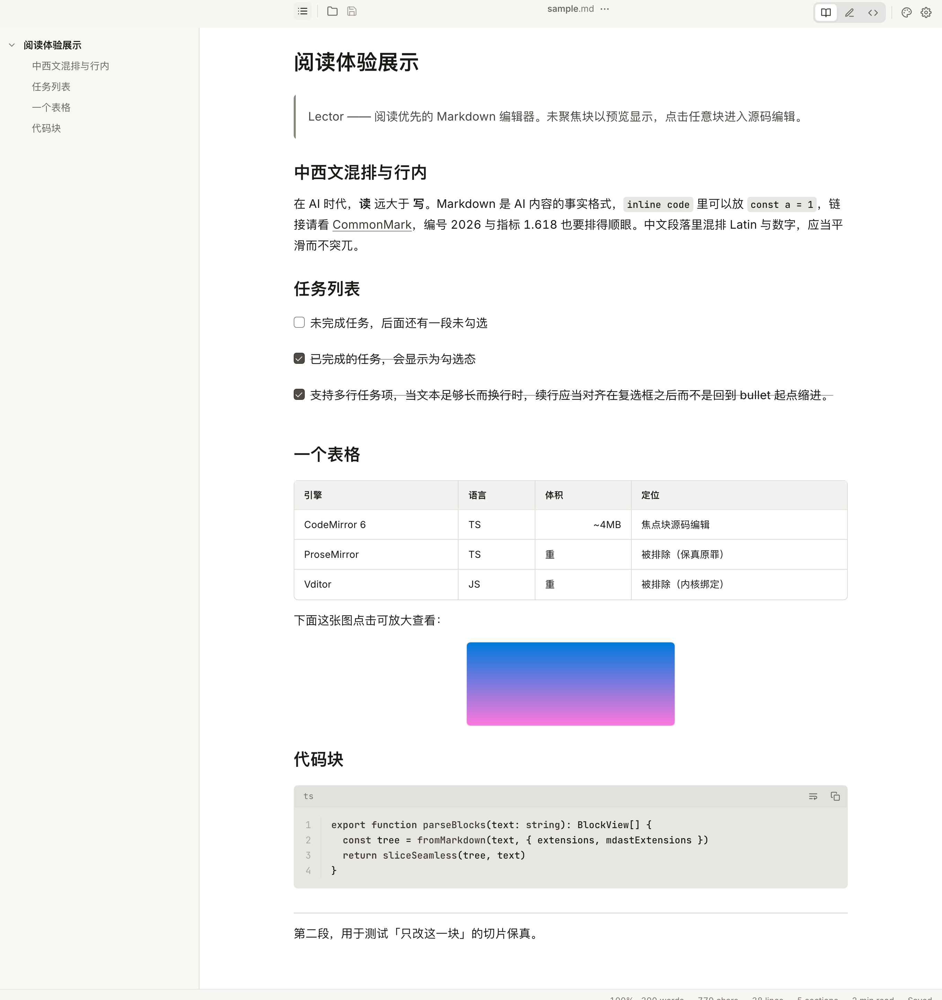
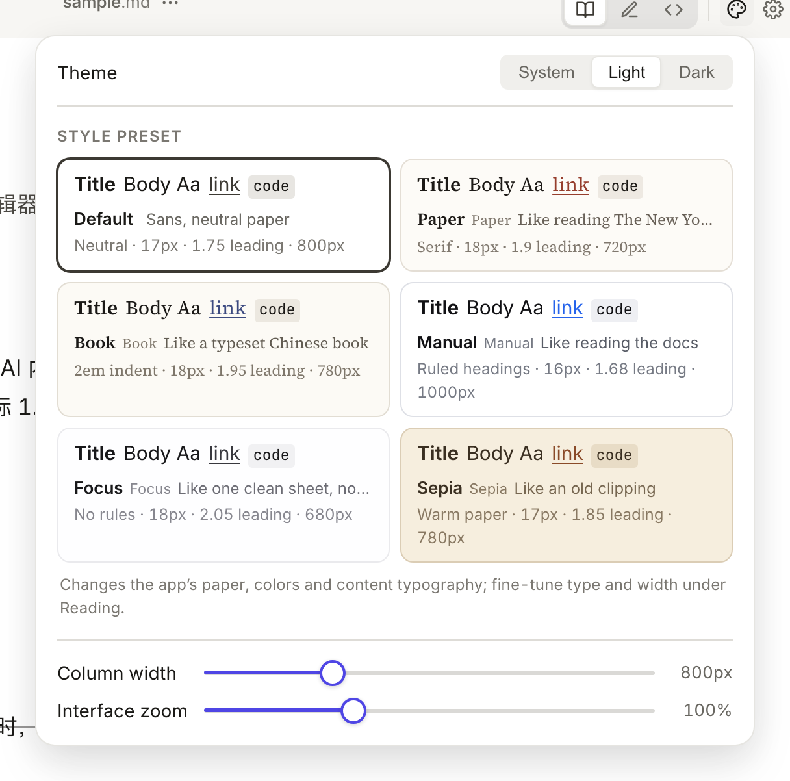
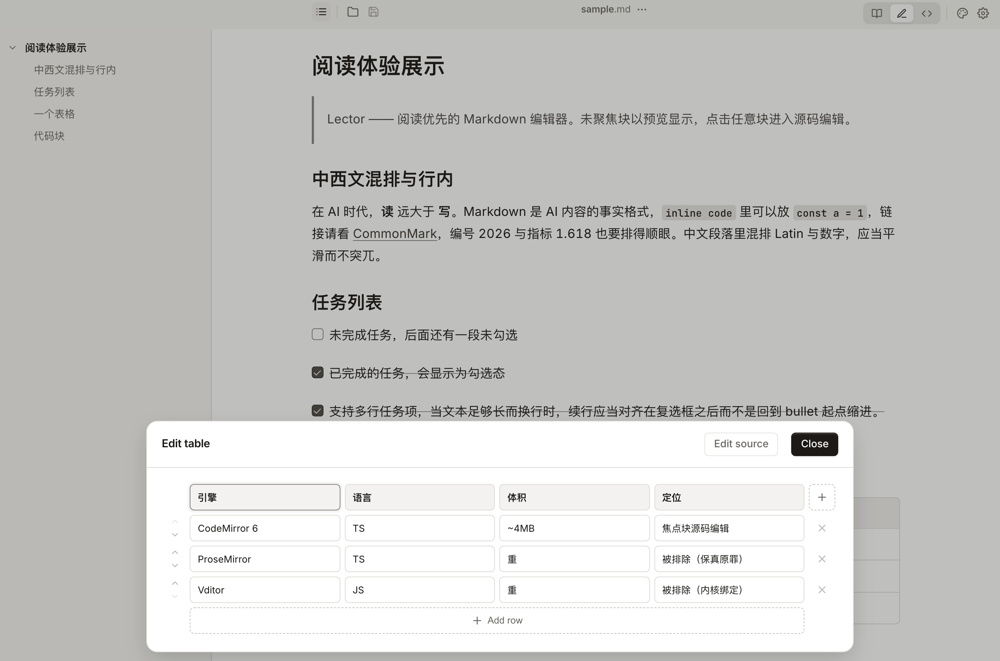
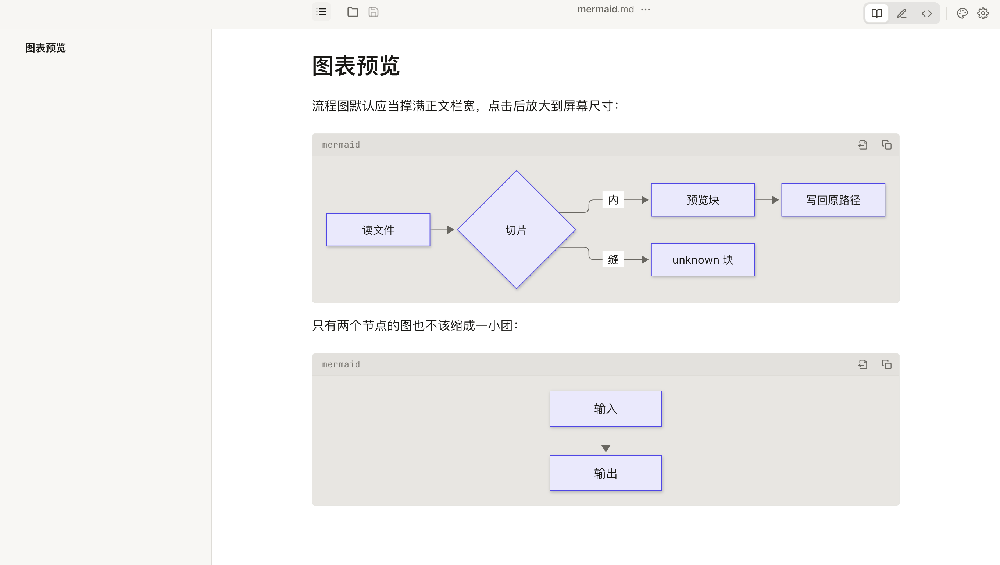

# Lector — a reading-first Markdown editor

A Markdown editor for Windows and macOS. The disk file is the single source of
truth: open it, read it, edit it in place, save back to the same path with
byte-level fidelity. Lector does not store, index, or shadow the document
anywhere else — no library, no workspace, no account, no sync.

Three things get the time: refinement, speed, and features. Each below.



[中文](README.md) ·
[Releases](https://github.com/atbeta/lector/releases) ·
[Changelog](CHANGELOG.md) ·
[Contributing](AGENTS.md)

## Refinement

Refinement means **every detail that shapes a reading judgement is calibrated.**

Six reading themes ship: Default, Paper, Book, Manual, Focus, and Sepia. Each is
a grouped typographic scheme — font / size / leading / column width — not a
palette:

| Theme   | Spec                                             |
| ------- | ------------------------------------------------ |
| Default | Neutral · 17px · 1.75 leading · 800px            |
| Paper   | Serif · 18px · 1.9 leading · 720px               |
| Book    | 2em indent · 18px · 1.95 leading · 780px         |
| Manual  | Ruled headings · 16px · 1.68 leading · 1000px    |
| Focus   | No rules · 18px · 2.05 leading · 680px           |
| Sepia   | Warm paper · 17px · 1.85 leading · 780px         |

Manual runs 1000px wide so tables and spec lists fit on one line; Focus narrows
to 680px so one paragraph is all you see; Book carries the first-line indent of a
typeset Chinese book; Paper is a serif news feel. All of it is calibrated against
1080p / 2K screens, keeping body text in the readable 38–48 characters per line.
Every theme is tunable, and a tuned theme is marked "tweaked" — its edited values
are never passed off as the theme's own.

The theme switcher shows preview cards, and **what the card shows is what you
get** — the rule inside the card is the rule in `reading-themes.css`, not a
separate mockup.



Reading position is remembered as scroll offset plus document length; when an
offscreen placeholder becomes a real-height block, scroll anchoring compensates
so the view is not yanked. Three status-bar readouts are clickable. UI zoom uses
the WebView's native zoom rather than a CSS `zoom` on `<html>` (which would break
the 100vh skeleton). HTML / script inside a document is neither rendered nor
executed; custom CSS is injected verbatim, after all built-in styles, so it can
override any rule.

## Speed

Speed is **measured, and budgeted.**

Double-click a `.md` while the app is already running and the body is in under
300ms; cold start is under 1.5s — the v1 success criteria written into
`AGENTS.md`.

Large files chunk-parse from around 3MB (`chunkParse`): the first screen lands
first and the rest is computed in the background. The block IR has an interactive
budget so scrolling never stalls, and the reading preview stays under 10MB. A
file too large, or one unsplittable run of lines, degrades to a single plain-text
buffer — still editable and saveable to the same path.

Resource handling is tuned too: word counts are computed in the background,
cheaply; shell paint is throttled while scrolling; wide tables are measured on
their own without repainting the page. Saving is atomic — temp file plus
`rename`, so a power loss mid-write never leaves half a file.

## Features

The things you expect from a desktop Markdown editor — Lector does them:

- **Popup table editing.** Click a table and edit it as a real grid (a
  dependency-free DOM rewrite); no more counting pipes in `| --- | --- |`.
- **Checkboxes.** Click an empty task box to tick it, without dropping to source.
- **Mermaid.** Inline rendering, click to zoom, copy / export PNG / JPEG / SVG,
  and a live preview while you edit — change a line, watch the diagram update.
- **KaTeX.** Inline and block math, in the document's theme colors.
- **Six typographic themes** + per-document tuning + **custom CSS** +
  **custom Mermaid config**.
- **Images.** Paste or drop and you are asked two things — a local copy (path
  template may use `{filename}.assets`), and an upload to your image host (the
  command you configure; the first http(s) URL on stdout is the result, falling
  back to the local copy on failure, **never losing an image**).
- **"Open with another app."** Pick an app in settings (icon + display name +
  path list) and hand the file straight to it from the menu.
- **Outline + reading-position memory.** Reopen a file and land where you left off.
- **Extended Markdown.** `==highlight==`, `:smile:` shortcodes, and the full GFM
  set (tables / tasks / strikethrough / autolink).
- **Find** (`Ctrl+F`) + **three view modes** (Read / Edit / Source, `Ctrl+1/2/3`).

Add or remove any extension and **not one byte on disk changes** — the trap that
makes people afraid to extend a Markdown tool.





## Platform support

| OS      | Status                                                    |
| ------- | --------------------------------------------------------- |
| Windows | Released (NSIS installer + portable archive, x86_64)      |
| macOS   | Released (signed & notarized DMG + ZIP, Apple Silicon)    |

Linux is not in scope.

## Install

Download the latest release from
[GitHub Releases](https://github.com/atbeta/lector/releases). Each release
provides:

- **Windows** — `Lector_<version>_x64-setup.exe` (NSIS installer, no admin
  required, registers `.md` / `.markdown` / `.txt` associations and an icon) and
  `lector-portable.zip` (portable archive; opt in to file associations via
  `register-file-assoc.cmd`).
- **macOS** — `Lector_<version>_arm64-apple-darwin.dmg` (signed and notarized
  disk image; drag `Lector.app` to Applications) and the matching `.zip`.
- **Checksums** — `SHA256SUMS.txt`. Verify with
  `certutil -hashfile <file> SHA256` on Windows or `shasum -a 256 <file>` on macOS.

## Develop

Requirements: [Bun](https://bun.sh) ≥ 1.4, [Rust](https://rustup.rs) stable with
the `x86_64-pc-windows-msvc` target on Windows, and the Tauri 2 prerequisites for
your platform.

```bash
git clone https://github.com/atbeta/lector
cd lector
bun install
bun run tauri:dev    # development run with hot reload
```

Quality gates (run before pushing):

```bash
bun test              # unit + golden tests in core and editor
bun run typecheck     # tsc --noEmit across all workspaces
node tools/design-audit.mjs   # design-token static audit
```

The shell's Rust unit tests run on the Windows CI runner (`cargo test --locked`);
run them locally on macOS or Linux with the matching target installed.

For architecture, locked decisions, and contribution conventions, see
[AGENTS.md](AGENTS.md).

## Release

```bash
node tools/release.mjs <version>
```

Bumps the four version sites, runs the local quality gates, generates a
per-version notes file from `CHANGELOG.md`, commits, tags, and pushes. CI on the
Windows runner verifies the tag, rebuilds, runs the silent install / uninstall /
registry assertion, and publishes the assets. The per-version release notes are
kept under [`.github/release-notes/`](.github/release-notes/); see
[CHANGELOG.md](CHANGELOG.md) for the full history.

## License

[MIT](LICENSE)
