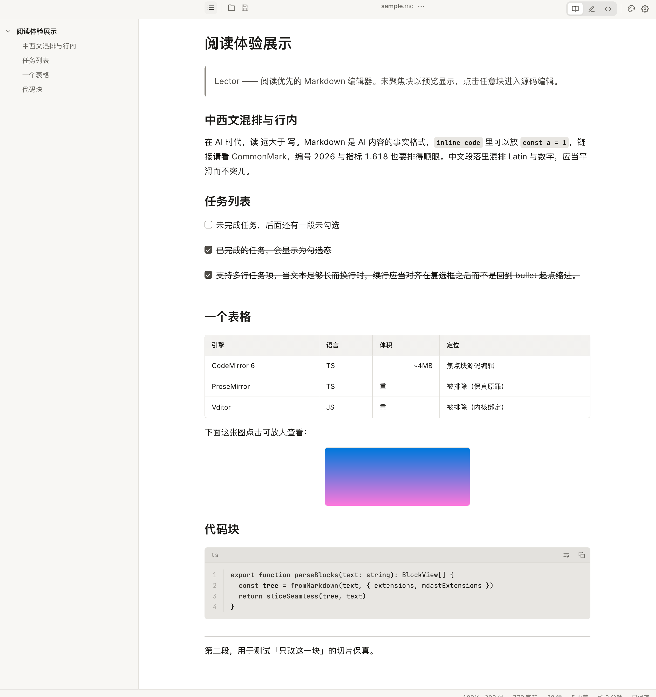
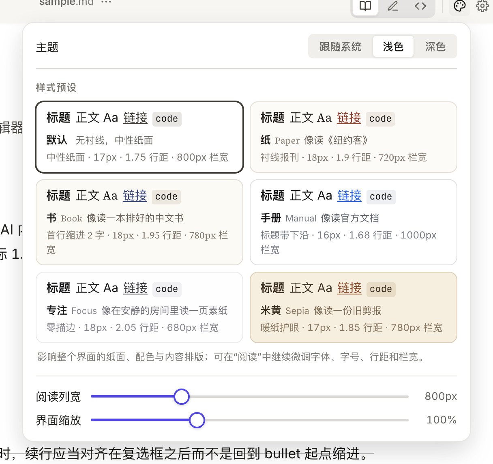
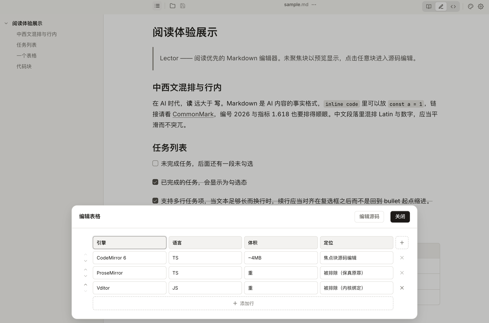

# Lector —— 阅读优先的 Markdown 编辑器

给 Windows 与 macOS 的 Markdown 编辑器。磁盘上的 `.md` 文件是唯一权威：打开即读，
就地编辑，保存写回同一路径，且保持字节级一致。Lector 不在任何其他地方存储、索引或
镜像你的文档——没有库、没有工作区、没有账号、没有同步。

三件花时间的事做得认真：精致、极速、功能丰富。下面分头说。



[English](README.en.md) ·
[Releases](https://github.com/atbeta/lector/releases) ·
[更新日志](CHANGELOG.md) ·
[参与贡献](AGENTS.md)

## 精致

精致是**每一个会影响阅读判断的细节都校过**。

预置六套阅读主题：默认、纸、书、手册、专注、米黄。每套是字体 / 字号 / 行距 / 栏宽成组的
排版方案，不是调色板：

| 主题 | 规格 |
| ---- | ---- |
| 默认 | 中性纸面 · 17px · 1.75 行距 · 800px 栏宽 |
| 纸   | 衬线报刊 · 18px · 1.9 行距 · 720px 栏宽 |
| 书   | 首行缩进 2 字 · 18px · 1.95 行距 · 780px 栏宽 |
| 手册 | 标题带下沿 · 16px · 1.68 行距 · 1000px 栏宽 |
| 专注 | 零描边 · 18px · 2.05 行距 · 680px 栏宽 |
| 米黄 | 暖纸护眼 · 17px · 1.85 行距 · 780px 栏宽 |

「手册」栏宽 1000px，让表格和参数表一行放得下；「专注」收到 680px，一眼只装得下一段话；
「书」带中文书那种首行缩进；「纸」是衬线报刊感——这些是按 1080p / 2K 屏标定过的，正文
守住 38–48 字/行这个可读区间。每套都能微调，改过会标「已微调」，不偷偷把数值说成主题值。

主题切换有预览卡，**卡上是什么样、选中后就是什么样**——卡里那条排版规则就是
`reading-themes.css` 里那条，不是另画一张示意图。



阅读位置记忆按滚动偏移 + 文档长度记录；占位块在视口上方换成真实高度时用滚动锚定补偿，
不让画面被拽走。状态栏三个数字可点击。界面缩放走 WebView 原生 zoom，不打 CSS zoom 到
`<html>`（避免破坏 100vh 骨架）。md 里的 HTML / script 不渲染也不执行；自定义 CSS 原样
注入、排在所有内置样式之后，能覆盖任何一条规则。

## 极速

极速是**测过、有预算的**。

应用已在跑时双击 `.md`，正文 < 300ms 进；冷启动 < 1.5s——这是 `AGENTS.md` 里写死的 v1
成功标准。

大文件 3MB 上下开始分块解析（`chunkParse`），首屏先到，剩下的后台继续算；块 IR 有交互
预算，读起来不能卡；阅读预览保持 < 10MB。太大或一大段没法切块的，整体降级成纯文本
buffer，照样能改能存。

资源处理也都是抠过的：状态栏字数在后台便宜地异步算、滚动时壳绘制节流、表太宽的时候单独
量不刷整个版面。写盘是原子的：临时文件 + `rename`，中途断电不会留半份。

## 功能丰富

桌面 Markdown 编辑器里常见的那几样，Lector 都做了：

- **表格弹窗编辑**：点开就是一张能编辑的表（无依赖的纯 DOM 重写），告别 `| --- | --- |` 数竖线。
- **复选框**：任务列表里的空框，点一下直接勾上，不切源码。
- **Mermaid**：内联渲染、点击放大、复制 / 导出 PNG / JPEG / SVG，编辑时还有实时预览，改一行立刻看到图变样。
- **KaTeX**：行内、独立成块都行，主题色跟全文。
- **六套排版主题** + 每篇文档独立微调 + **自定义 CSS** + **自定义 Mermaid 配置**。
- **图片**：粘贴 / 拖入时问两件事——要不要本地副本（路径模板可写 `{filename}.assets`），
  要不要上传图床（你配的命令，stdout 第一个 http(s) URL 算结果，失败退回本地副本，**绝不丢图**）。
- **「用其他应用打开」**：设置里挑一个应用（图标 + 显示名 + 路径列表），菜单里就把文件直接交给它。
- **大纲 + 阅读位置记忆**：重开文件回到上次看到的地方。
- **扩展 Markdown**：`==高亮==`、`:smile:` 短代码、GFM 全套（表格 / 任务 / 删除线 / autolink）。
- **查找**（`Ctrl+F`）+ **三档视图**（Read / Edit / Source，`Ctrl+1/2/3` 切换）。

新增 / 关闭任何扩展，**磁盘上的字节一个不动**——这是做扩展最怕踩的坑。




## 平台支持

| 系统    | 状态                                              |
| ------- | ------------------------------------------------- |
| Windows | 已发布（NSIS 安装器 + 便携压缩包，x86_64）         |
| macOS   | 已发布（已签名并公证的 DMG + ZIP，Apple Silicon） |

Linux 不在支持范围内。

## 安装

从 [GitHub Releases](https://github.com/atbeta/lector/releases) 下载最新版本。每个版本提供：

- **Windows** —— `Lector_<版本>_x64-setup.exe`（NSIS 安装器，无需管理员权限，
  注册 `.md` / `.markdown` / `.txt` 文件关联与图标）与 `lector-portable.zip`
  （便携压缩包；如需文件关联，运行 `register-file-assoc.cmd`）。
- **macOS** —— `Lector_<版本>_arm64-apple-darwin.dmg`（已签名并公证的磁盘映像；
  将 `Lector.app` 拖入「应用程序」）以及对应的 `.zip`。
- **校验和** —— `SHA256SUMS.txt`。Windows 上用 `certutil -hashfile <文件> SHA256`
  校验，macOS 上用 `shasum -a 256 <文件>`。

## 开发

依赖：[Bun](https://bun.sh) ≥ 1.4、stable 版 [Rust](https://rustup.rs)
（Windows 上需 `x86_64-pc-windows-msvc` target），以及对应平台的 Tauri 2 前置条件。

```bash
git clone https://github.com/atbeta/lector
cd lector
bun install
bun run tauri:dev    # 带热重载的开发运行
```

质量门（推送前运行）：

```bash
bun test              # core 与 editor 的单元测试 + 黄金测试
bun run typecheck     # 所有 workspace 的 tsc --noEmit
node tools/design-audit.mjs   # 设计 token 静态审计
```

壳层的 Rust 单元测试运行在 Windows CI runner 上（`cargo test --locked`）；
在本机 macOS 或 Linux 上运行需安装对应的 target。

架构、已锁定的决策与贡献约定见 [AGENTS.md](AGENTS.md)。

## 发版

```bash
node tools/release.mjs <版本>
```

更新四处版本号，运行本地质量门，从 `CHANGELOG.md` 生成本版说明文件，提交、打 tag 并推送。
Windows runner 上的 CI 会校验 tag、重新构建、运行静默安装 / 卸载 / 注册表断言，并发布产物。
每版发行说明保存在 [`.github/release-notes/`](.github/release-notes/)；
完整历史见 [CHANGELOG.md](CHANGELOG.md)。

## 许可

[MIT](LICENSE)
